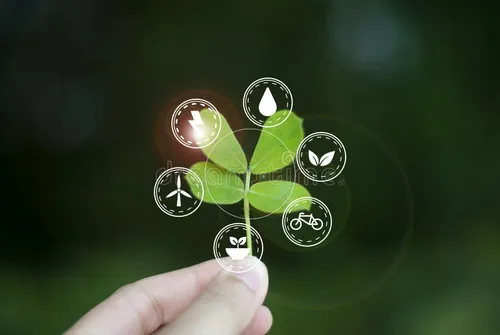

[Volver al indice general](https://github.com/davidlpizano/SOSTENIBILIDAD)

> "La sostenibilidad es un concepto que busca satisfacer las necesidades del presente sin comprometer la capacidad de las generaciones futuras para satisfacer las suyas."

---
### Notas:
